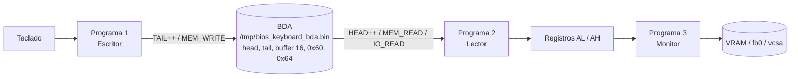
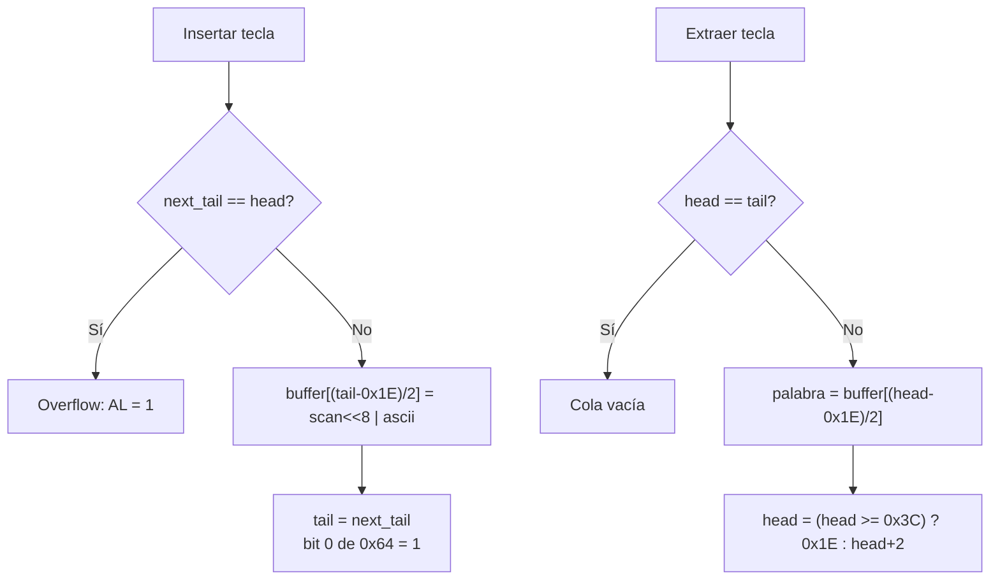
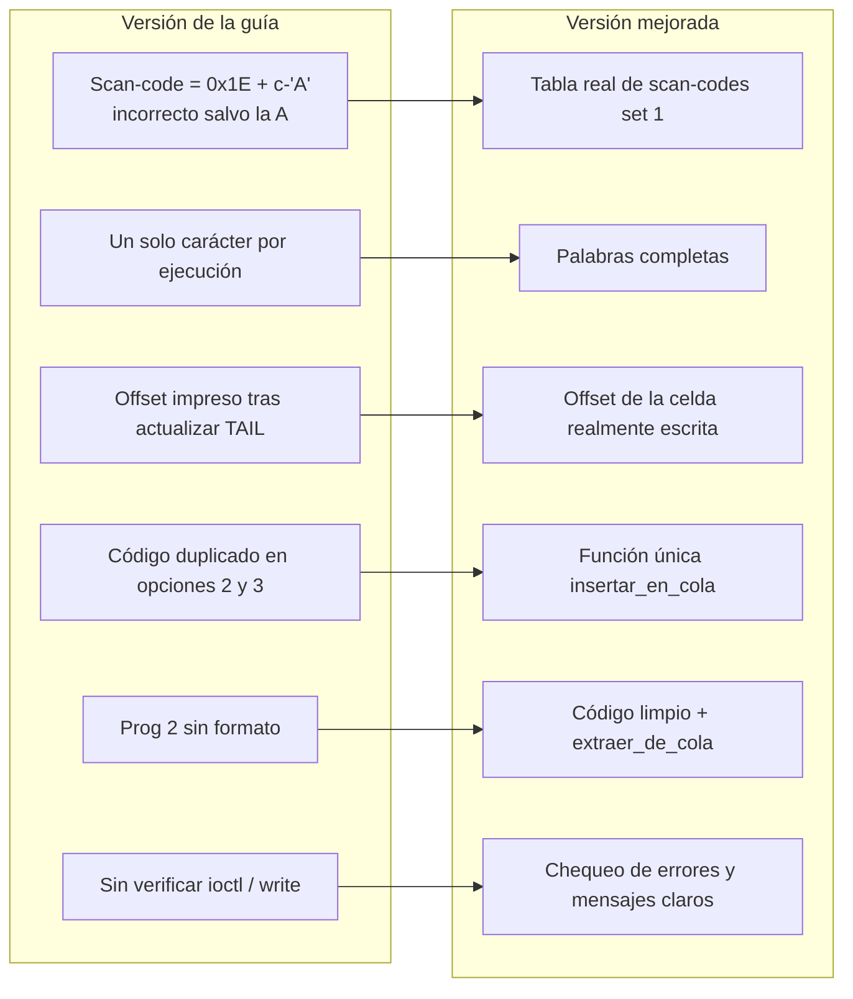

# Comparación y Mejoras de los Programas en C

Laboratorio: Entradas, Salidas y Memoria de Video (VRAM).

## 1. Resumen de los tres programas

| Programa | Archivo | Función | Mecanismos que demuestra |
|---|---|---|---|
| 1 | `prog1_escribir_cola.c` | **Escribe** teclas en la cola de teclado | `ioctl TIOCSTI`, `INT 16h/05h`, escritura directa en la BDA |
| 2 | `prog2_leer_teclado.c` | **Lee** teclas del teclado | `scanf`, `getc`, `IN AL,60h`, lectura directa de RAM, `INT 16h/00h` |
| 3 | `escribir_monitor_linux.c` | **Escribe** en la memoria de video | `/dev/fb0`, `/dev/vcsa`, `/dev/mem` + ASM, VRAM didáctica |

Los programas 1 y 2 comparten el archivo `/tmp/bios_keyboard_bda.bin`, que simula la BDA (BIOS Data Area, segmento `0x0040`). El Programa 1 es el **productor** y el Programa 2 es el **consumidor**.

## 2. Diferencias entre los programas

| Aspecto | Programa 1 | Programa 2 | Programa 3 |
|---|---|---|---|
| Dirección del dato | CPU → cola | cola / puerto → CPU | CPU → pantalla |
| Puntero que modifica | `TAIL` | `HEAD` | (ninguno) |
| Señales de bus | `MEM_WRITE` | `MEM_READ` / `IO_READ` | `MEM_WRITE` |
| Condición clave | Cola llena: `next_tail == head` | Cola vacía: `head == tail` | Límites de pantalla |
| Estructura central | `BiosKeyboardMemory` | `BiosKeyboardMemory` | `CeldaVram` (ASCII + atributo) |
| Persistencia | Archivo en `/tmp` | Archivo en `/tmp` | Memoria del proceso / dispositivos |

## 3. Gráfico del flujo entre programas



## 4. Cola circular de la BDA



La cola tiene 16 palabras (offsets `0x1E..0x3C`). Siempre queda una celda libre para distinguir "llena" de "vacía", por lo que la capacidad útil es de **15 teclas**.

## 5. Gráfico de mejoras (versión de la guía → versión entregada)



### Detalle de las mejoras

| Programa | Problema en la guía | Mejora aplicada |
|---|---|---|
| 1 | Scan-code calculado como `0x1E + (c - 'A')`: solo la `A` es correcta (en QWERTY los códigos no son alfabéticos) | Tabla `scan_de()` con los códigos reales (set 1) para letras, dígitos, espacio y Enter |
| 1 | Solo se enviaba un carácter | Se procesa la cadena completa hasta llenar la cola |
| 1 | En la opción 3 se imprimía `bda.tail` ya actualizado como "offset escrito" | Se devuelve y muestra el offset real de la celda escrita |
| 1 | La lógica de inserción estaba duplicada | Función única `insertar_en_cola()` |
| 1 | `TIOCSTI` falla en Linux ≥ 6.2 sin explicación | Mensaje con el `sysctl` que lo habilita (solo para práctica) |
| 2 | Código entregado sin espacios ni formato | Código limpio |
| 2 | Extracción de cola duplicada en opciones 4 y 5 | Función única `extraer_de_cola()` |
| 2 | Condición de puerto confusa (`status==0 && data==0`) | Se usa solo el bit 0 de `0x64`, y se limpia tras leer (handshake) |
| 2 | Imprimía caracteres no imprimibles tal cual | Función `imprimible()` |
| 3 | `ioctl`, `lseek` y `write` sin verificar | Chequeo de errores en cada llamada |
| 3 | El cuadrado asumía 32 bpp y podía salirse de pantalla | Soporta 16 y 32 bpp y recorta a los límites |
| 3 | La opción 3 sugería ejecutar `/dev/mem` | Solo muestra el código y advierte del riesgo |
| 3 | Escritura de texto repetida en la VRAM didáctica | Función `escribir_texto()` con recorte de columnas |

## 6. Registros de CPU simulados

| Registro | Contenido tras `INT 16h` (servicio 00h) |
|---|---|
| `AL` | Código ASCII (byte bajo de la palabra) |
| `AH` | Scan-code (byte alto de la palabra) |
| `AX` | Palabra completa de 16 bits |

## 7. Regla de bus (del manual)

En cada ciclo debe cumplirse: `MEM_READ + MEM_WRITE + IO_READ + IO_WRITE ≤ 1`.

- Programa 1 (opción 3) usa `MEM_WRITE`.
- Programa 2 (opción 3) usa `IO_READ` (puerto `0x60`); (opción 4) usa `MEM_READ`.
- Cuando `IO_READ = 1`, la RAM queda inhibida, por eso la dirección `0x60` de puerto no colisiona con la dirección de memoria `0x60`.

## 8. Compilación y prueba

```bash
gcc -Wall -Wextra -pedantic prog1_escribir_cola.c   -o prog1
gcc -Wall -Wextra -pedantic prog2_leer_teclado.c    -o prog2
gcc -Wall -Wextra -pedantic escribir_monitor_linux.c -o monitor_linux
```

Prueba sugerida:
1. `./prog1` → opción 3 → escribir `hola` (4 teclas en la cola).
2. `./prog2` → opción 4 (cuatro veces) → salen `h`, `o`, `l`, `a` en orden FIFO.
3. `./prog2` → opción 3 → lee el scan-code del puerto y limpia el bit de estado.
4. `./monitor_linux` → opción 4 → muestra la VRAM didáctica (no requiere permisos).

Las opciones 1 y 2 del Programa 3 necesitan una consola TTY real (Ctrl+Alt+F3) y `sudo`.
